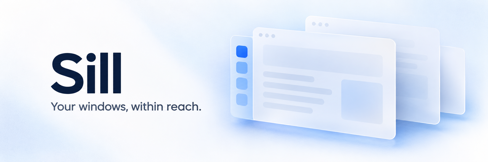

# Sill

**English** · [简体中文](README.zh-CN.md)

A native macOS window sidebar. Keep your windows at the edge of the screen, hover to expand, and click to switch.

Built with Swift, AppKit, and SwiftUI. No third-party dependencies.

## Features

- **Windows within reach.** App icons, window titles, active-window highlighting, and actions to switch, minimize, or close windows.
- **A sidebar that fits your desktop.** Left or right edge, four collapsed/expanded modes, adjustable size, and light, dark, or system appearance.
- **Readable titles.** Automatic 300–420 pt expansion, a steady list height, and wrapping full-title previews on hover. Manual width remains available in Sidebar settings.
- **Native Liquid Glass.** Choose Liquid Glass, Clear Glass, or Classic Frosted in Settings. Glass effects require macOS 26+; earlier systems use frosted material.
- **Fast window search.** Search app names and window titles in English, Chinese, full pinyin, or pinyin initials. Mix multiple keywords in one query.
- **Flexible organization.** Keep the same app’s windows together within each group, group by app or visibility, choose which displays and windows to show, and exclude apps or matching window titles.
- **Optional window clearance.** Reserve space for the sidebar and restore windows adjusted during the current session.
- **Native preferences.** English and Simplified Chinese, launch at login, and a menu bar entry. Opening Settings shows a Dock icon; closing Settings keeps the sidebar running.

Sill is an early-stage project. See [compatibility and validation](docs/parity.md) for supported behavior and remaining gaps.

## Build and install

Runtime: **macOS 14 or later**. Building requires **Xcode 26+ with the macOS 26+ SDK and Swift 6.2+**, on a Mac that supports that Xcode version. The app targets macOS 14; not every OS version or hardware configuration has been tested.

Clone and build:

```sh
git clone https://github.com/microstudent/sill.git
cd sill
swift test
./scripts/build-app.sh
open build/Sill.app
```

To build and install to `~/Applications/Sill.app`:

```sh
./scripts/install-app.sh
open ~/Applications/Sill.app
```

Quit an existing Sill instance before replacing it. The install script replaces an existing Sill app at that location and refuses to overwrite an app with a different bundle identifier.

These scripts produce a local development build, not a notarized release. They use an available Apple Development signing identity, falling back to ad-hoc signing. See [development and signing](docs/DEVELOPMENT.md) for explicit signing options.

## First launch

1. Open Sill and choose **Open Accessibility Settings**.
2. Enable Sill in **System Settings → Privacy & Security → Accessibility**. Use **Show App in Finder** if you need to locate the app.
3. Hover over the sidebar to expand it, then click a window to switch.
4. Open **Appearance & Language** to choose English, Simplified Chinese, or the system language.

Accessibility access is used to read window titles and switch, minimize, close, or resize windows. Sill does not require Screen Recording access. Window information and pinyin conversion stay on your Mac; the app has no network requests, analytics, or window-title logging.

If access stops working after a rebuild or a change of signing identity, remove and re-add the installed app in Accessibility settings.

## Keyboard shortcuts

| Shortcut | Action |
| --- | --- |
| `Control` + `Option` + `Space` | Open window search |
| `↑` / `↓`, `Tab` / `Shift` + `Tab` | Select a search result |
| `Return` | Switch to the selected window |
| `Escape` | Dismiss search |
| `Command` + `W` / `M` / `H` | In search: close the selected window, minimize it, or hide its app |
| `Control` + `Option` + `1` … `9` | Switch by sidebar position; enable in Settings first |

For example, `weixin` or `wx` finds 微信; `yingyongchengxu` or `yycx` finds 应用程序. Mixed queries such as `xmsz workspace` are supported. Pronunciation follows the system's offline transliteration.

## Current limitations

- Spaces and visibility are inferred through public macOS APIs. Desktop numbers are unavailable, and some apps expose windows only after their Space has been visited. Switching can be restricted by macOS or the target app.
- Automatic window clearance is off by default. It may compete with other window managers; restoration is limited to the current session and windows that have not subsequently been changed.
- Command–Tab replacement, hold-Fn search, drag-and-drop grouping, Dock badges, global trackpad-edge gestures, and search learning or typo tolerance are not implemented.
- Multi-display hardware, Stage Manager, Intel Macs, and launch-at-login behavior still need broader validation.

## Contributing

Bug reports, documentation improvements, translations, and focused pull requests are welcome. English and Chinese are both welcome in issues and pull requests.

Read [CONTRIBUTING.md](CONTRIBUTING.md) for the workflow and [development notes](docs/DEVELOPMENT.md) for the code layout and local checks.

## Inspiration

Sill is inspired by [Contexts](https://contexts.co/) and its convenient sidebar approach to switching windows. Thank you to the Contexts creators for the inspiration.

Sill is an independent implementation, not a source-code fork, and is not affiliated with or endorsed by Contexts. The README banner is an AI-generated illustration, not an application screenshot.

## License

[MIT](LICENSE) © 2026 leavesgeek. This license applies to Sill; it does not grant rights to Contexts or its branding.
